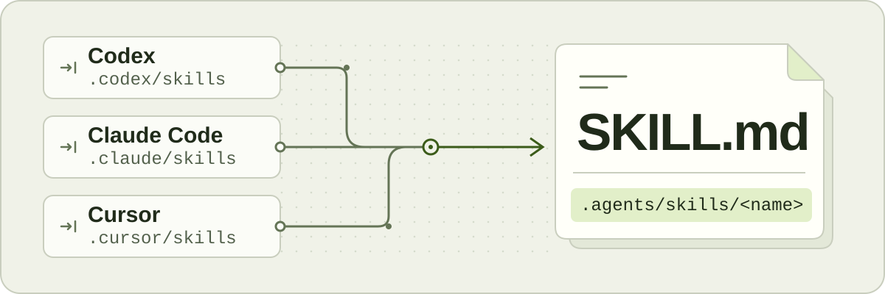

# Skills Console

**用 CLI 和本机 Web 界面管理全局与项目里的 Agent Skills。** 在一个地方查看 Codex、Claude Code 和 Cursor 的安装位置、来源与更新状态。

<picture>
  <source media="(prefers-color-scheme: dark)" srcset="docs/readme/hero-dark.svg">
  
</picture>

[快速开始](#快速开始) · [日常使用](#日常使用) · [命令速查](#命令速查) · [产品方案](docs/product.md) · [技术方案](docs/architecture.md)

## 快速开始

在仓库根目录运行。需要 Node.js **22.20+** 和 pnpm，仓库推荐的 Node.js 版本见 [`.node-version`](.node-version)。

```bash
pnpm install
pnpm build
pnpm start ui
```

浏览器会打开 [本机控制台](http://127.0.0.1:59726/)。服务默认在后台运行，关闭终端后仍可访问。再次启动会复用现有服务并登记当前目录，通过 `pnpm start status` 查看状态，或用 `pnpm start stop` 停止服务。

> [!NOTE]
> 当前从源码运行，也可用 `pnpm pack` 生成 npm 安装包。npm 发布后可用 `npx skills-console ui` 启动。

## 日常使用

### 盘点安装

- 从侧栏切换「全局 Skills」或已登记项目。「添加项目」只登记路径。项目视图可选择「包含全局可见候选」，查看 Agent 可能读取的内容。
- 按 <kbd>/</kbd> 聚焦搜索，可查名称、描述、来源，或按工具、来源类型和诊断筛选。打开详情可看 Markdown、资源清单、各安装入口、真实路径和版本证据。按 <kbd>Esc</kbd> 关闭详情或对话框。
- 「刷新扫描」只重读本机文件。展开扫描位置可查看缺失或读取失败的目录。

### 安装与卸载

1. 选择「安装 Skill」，输入本机目录、`owner/repo`、Git URL 或 GitHub tree 目录地址。本机目录建议使用绝对路径或以 `~/` 开头。Git 来源可指定分支、标签或提交。
2. 选择 Skill、安装范围和工具。确认预览中的来源、提交及目标位置后，控制台会复制内容到该范围的 `.agents/skills/<name>`，再为所选工具创建入口。
3. 在详情中打开真实目录或单个安装入口。卸载时选择要移除的位置，确认后控制台将它们移入备份。本次会话可撤销卸载。

> [!IMPORTANT]
> 安装和卸载都要先预览再确认。新安装会保留已有目录、链接和同名锁记录。卸载工具链接会保留源内容。若已登记项目仍引用共享内容，控制台会停止移除该内容。

<details>
<summary>目录行为、备份与安装限制</summary>

- 「打开目录」通过系统文件管理器打开已扫描到的位置。失效链接会打开其上级目录。外部托管内容由原工具管理，安装根目录本身是链接时应在源目录管理。
- 卸载备份和操作记录保存在配置目录旁的 `operations/<操作ID>/`，记录仅当前用户可读。重启后可依据 `operation.json` 手动恢复。撤销前会检查原位置、备份与锁文件，跨磁盘无法移动备份时会保留原内容。浏览器操作期间请保持本机服务运行。
- 安装上限为 20 MiB、2000 项，含内部软链接的来源会停止安装。复制时排除 `node_modules`、`.git`、`metadata.json` 和运行缓存。安装流程仅复制 Skill 内容。
- 远端来源需要系统 Git。私有仓库复用本机已有的 Git 凭据，地址中无需填写密码或 Token。凭据由本机 Git 管理。

</details>

### 检查更新

从右上角「检查更新」检查当前范围，也可打开详情中的「安装与来源」单独检查。项目视图选择「包含全局可见候选」后，批量检查也会覆盖全局。「有更新」只筛出确认存在上游变化的 Skill。

手工安装也可以在详情中「补录来源」，关联 Git 或本机目录，以及可选的跟踪目标和子目录。内容一致时建立本地核验基线。若内容有差异，仍可保存关联，历史版本显示为未知。

<details>
<summary>如何读取版本和检查结果</summary>

- 列表展示作者声明的版本、锁文件记录的短提交或内容指纹，以及来源和检查状态。GitHub 全局安装比较 Skill 目录的 Git tree，项目安装比较对应 schema 的内容哈希。检查覆盖整个 Skill 目录，作者声明版本和仓库其他目录的提交不参与比较。
- 分支跟踪分支头，留空跟踪默认分支，标签和固定提交保持原目标。手动来源关联可编辑或移除，记录保存在本工具配置目录。
- 上游状态与本地核验分别显示。只有可信的安装内容基线或项目内容哈希才能确认本地变化。当前文件和来源一致时，可确认当前内容一致，历史安装提交仍以已有记录为准。
- 刷新扫描不联网。显式检查或来源核验才读取上游，批次内同一来源和 ref 共用获取结果，最多 3 项并发。缓存会因本地内容变化而失效，超过 24 小时后标记为待重新检查。网络失败、权限错误、来源未知或不受支持会各自显示，内部软链接和超限内容会停止核验。

</details>

当前版本提供更新检查。覆盖升级仍在规划中，计划加入预览、备份、冲突保护和更完整的三方差异比较。

## 命令速查

| 想做什么                    | 命令                                                          |
| --------------------------- | ------------------------------------------------------------- |
| 启动 Web 界面并登记指定项目 | `pnpm start ui --project /absolute/path/to/project`           |
| 盘点全局安装                | `pnpm start list --global`                                    |
| 以 JSON 盘点项目安装        | `pnpm start list --project /absolute/path/to/project --json`  |
| 以 JSON 检查全局更新        | `pnpm start check --json`                                     |
| 以 JSON 检查项目更新        | `pnpm start check --project /absolute/path/to/project --json` |
| 查看或停止后台服务          | `pnpm start status` / `pnpm start stop`                       |

<details>
<summary>端口、额外扫描目录与隔离配置</summary>

```bash
# 自定义启动端口并跳过打开浏览器
pnpm start ui --port 4317 --no-open

# 前台调试，按 Ctrl+C 停止
pnpm start ui --foreground --no-open

# 增加全局扫描目录
pnpm start ui --root /absolute/path/to/custom-skills

# 隔离用户目录和配置
pnpm start ui --home /absolute/path/to/test-home --config /absolute/path/to/config.json
```

`list` 默认盘点全局，`--global` 和 `--project` 互斥。设置独立 `--home` 后，扫描会忽略真实账号的 `CODEX_HOME` 和 `XDG_STATE_HOME`。使用自定义 `--home` 或 `--config` 启动时，`status` 和 `stop` 也要传入相同配置。

已有后台服务会保持原端口和扫描目录。要切换端口、扫描目录或加载重新构建的后端，请先停止服务再启动。后台服务由命令启动，系统开机时需重新启动。

</details>

## 兼容性与数据

默认扫描共享目录 `.agents/skills`，以及 `.codex/skills`、`.claude/skills`、`.cursor/skills`。遇到容器目录时最多向内发现三层。详情文件清单达到深度或数量上限时会提示。

| 安装情况                         | 盘点方式                                                           |
| -------------------------------- | ------------------------------------------------------------------ |
| Skills CLI 安装                  | 在对应范围内核对位置，再关联锁文件里的来源、ref、commit 和内容指纹 |
| 手工目录                         | 展示文档和位置，缺少版本证据时显示「未知」                         |
| 同一范围内指向同一真实目录的链接 | 合并展示并保留所有入口                                             |
| 同名独立目录                     | 分开显示，各自核对来源                                             |
| 内置或外部托管内容               | 标记为外部管理                                                     |
| 无效文档、失效链接、异常锁文件   | 展示可用条目或诊断，继续扫描其他目录                               |

<details>
<summary>锁文件、配置位置与本机访问</summary>

- 全局 lock 支持 schema 3，项目 lock 支持 schema 1/2，遇到未知格式只报告。工具专用目录里的独立副本仅有同名 lock 时，会提示来源尚未核实。工具图标对应实际扫描到的入口，Agent 在某次对话中是否调用仍未知。
- 盘点直接读取原文件。资源中的内部链接只列出，指向内容目录之外的 `SKILL.md` 链接会跳过。安装快照使用临时目录。
- 项目登记默认保存在 `~/.config/skills-console/config.json`，可通过 `--config` 覆盖。同目录内的 `versions.json` 保存来源及检查结果，`service.json` 记录后台实例信息，`service.log` 保存运行日志。异常项目配置会保留供排查。
- Web 服务只监听 `127.0.0.1`，无需会话 Token，校验 Host、Origin 和跨站请求，写操作还要求同源自定义请求头。

</details>

目前优先在 macOS 上验证。目录与链接实现兼顾 Windows 和 Linux，两者尚待实机验证。

## 开发与验证

```bash
pnpm check
pnpm test
pnpm build
pnpm smoke
pnpm test:e2e # 使用本机 Google Chrome
```

测试在临时 home 和项目中创建真实文件与链接，现有 Skill 和账号数据均保留原状。运行前请确认 PATH 中的 Node.js 满足版本要求。

## 许可证

[MIT](LICENSE) · [第三方许可与声明](docs/third-party-notices.md)
